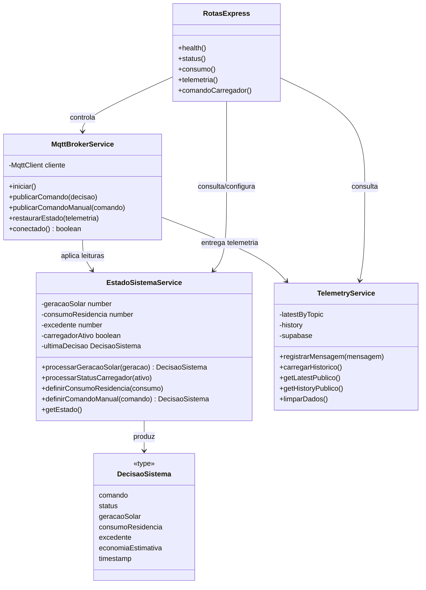
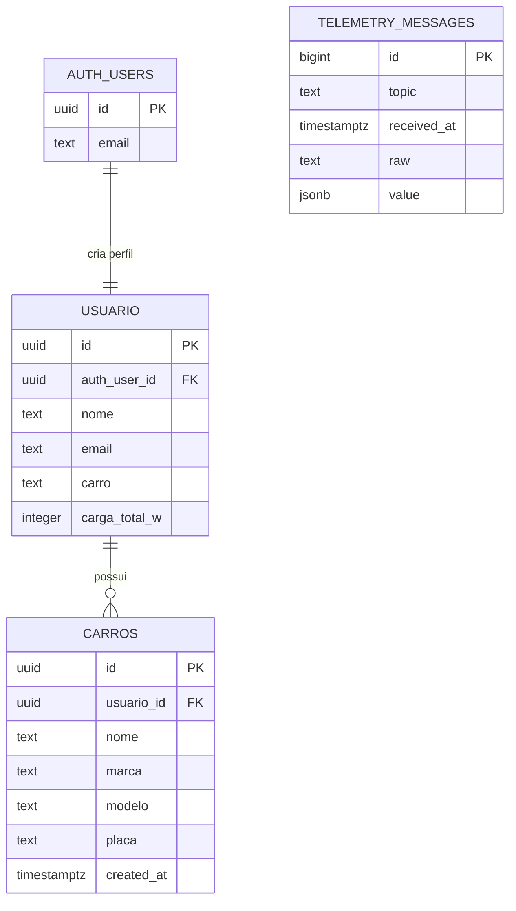

# Relatório de Análise e Desenvolvimento do SolarSync

**Projeto:** SolarSync  
**Disciplina:** UPX III: Energias Renováveis  
**Curso:** Análise e Desenvolvimento de Sistemas — UniFacens  
**Data de referência:** 05/11/2026

## 1. Levantamento de requisitos

### 1.1 Contexto e dores da persona

O SolarSync atende uma residência com geração fotovoltaica, cargas elétricas e um veículo elétrico. As principais dores identificadas são:

- falta de visibilidade, em tempo real, sobre geração, consumo e uso da rede;
- desperdício de excedente solar ou injeção na rede quando ele poderia ser usado no carregamento;
- necessidade de configurar a carga residencial conforme o perfil da casa;
- dificuldade de acompanhar o histórico de geração;
- necessidade de controlar e acompanhar veículos associados ao usuário;
- risco de expor dados de usuários e veículos sem isolamento por conta.

### 1.2 Requisitos funcionais

| Código | Requisito | Dor atendida | Evidência no projeto |
|---|---|---|---|
| RF01 | Receber telemetria de geração solar via MQTT. | Falta de dados atualizados. | `MqttBrokerService` assina o tópico de geração. |
| RF02 | Comparar geração solar com o consumo residencial. | Desperdício do excedente. | `EstadoSistemaService.processarGeracaoSolar`. |
| RF03 | Ligar ou desligar o carregador automaticamente. | Uso ineficiente do excedente. | Publicação no tópico de comando do carregador. |
| RF04 | Permitir comando manual protegido por chave de API. | Necessidade de intervenção operacional. | `POST /commands/carregador`. |
| RF05 | Exibir status, geração, consumo, rede e carregamento. | Falta de visibilidade. | Dashboard “Agora” e endpoint `/status`. |
| RF06 | Transmitir atualizações em tempo real. | Atraso entre medição e visualização. | Socket.IO e eventos `telemetry:update`/`telemetry:snapshot`. |
| RF07 | Persistir e consultar histórico de telemetria. | Impossibilidade de analisar o comportamento anterior. | Tabela `telemetry_messages` e rotas `/telemetry/*`. |
| RF08 | Filtrar e visualizar a curva de geração. | Dificuldade de identificar variações. | Aba “Monitoramento”, por data e horário. |
| RF09 | Configurar a carga residencial. | Consumo varia de uma residência para outra. | Campo `carga_total_w` e `POST /status/consumo`. |
| RF10 | Autenticar o usuário e criar seu perfil. | Acesso não controlado aos dados. | Supabase Auth, `AuthGate` e trigger de perfil. |
| RF11 | Cadastrar e remover veículos do usuário. | Organização da garagem e das cargas. | Aba “Garagem” e tabela `carros`. |
| RF12 | Limpar o histórico de telemetria. | Necessidade de reiniciar dados de teste/operação. | `DELETE /telemetry/data`. |

### 1.3 Requisitos não funcionais

| Código | Requisito | Como é atendido |
|---|---|---|
| RNF01 | Segurança e isolamento de dados. | RLS nas tabelas de usuário e veículos; comando manual protegido por `x-api-key`. |
| RNF02 | Disponibilidade e reconexão. | Cliente MQTT usa reconexão automática a cada 5 segundos e expõe health check. |
| RNF03 | Desempenho percebido. | Atualização via WebSocket, sem necessidade de polling contínuo do dashboard. |
| RNF04 | Manutenibilidade. | Monorepo separado em API, web e contratos compartilhados, com TypeScript. |
| RNF05 | Interoperabilidade. | MQTT para IoT, REST para operações e Socket.IO para eventos. |
| RNF06 | Rastreabilidade. | Tópicos, decisões e registros possuem timestamp; contratos compartilhados documentam o formato. |
| RNF07 | Tratamento de erros. | Validação de entrada, respostas HTTP adequadas e mensagens de erro no frontend/backend. |

## 2. Descrição das funções do projeto

### 2.1 Coleta e processamento

O ESP32 solar publica uma leitura no tópico `casa/solar/geracao`. O backend interpreta payloads numéricos, textuais ou objetos com campos conhecidos. Quando a leitura é válida, calcula:

`excedente = geração solar - consumo residencial`

Se a geração for maior que o consumo, o sistema define o carregador como ligado e publica o comando `ligar`; caso contrário, publica `desligar`. A decisão também registra geração, consumo, excedente, economia estimada e timestamp.

Essa função traduz diretamente a dor de desperdício do excedente em uma regra de negócio automatizada. A economia estimada, no estágio atual, corresponde ao excedente positivo em watts; ela ainda não representa um valor monetário calculado por tarifa.

### 2.2 Dashboard

O dashboard possui as seguintes áreas:

- **Agora:** geração, cobertura solar, carga total, rede elétrica e fluxo de energia;
- **Monitoramento:** gráfico da geração solar, com filtros de dia e horário;
- **Cargas:** últimos tópicos, estado do carregador e limpeza de dados;
- **Histórico:** lista de leituras recebidas;
- **Garagem:** perfil, carga residencial e veículos cadastrados.

As áreas são alimentadas inicialmente por REST e continuam recebendo eventos por Socket.IO. Assim, a funcionalidade RF06 é associada tanto à API quanto à experiência de acompanhamento em tempo real.

### 2.3 Conta, perfil e garagem

O usuário pode criar uma conta, entrar e sair do sistema. Após o cadastro, uma trigger cria o registro correspondente em `public.usuario`. A carga residencial pode ser alterada e é sincronizada com a API. Veículos são vinculados ao perfil por `usuario_id`, e as políticas RLS restringem leitura, inserção e exclusão aos dados do próprio usuário.

## 3. Desenvolvimento do projeto

### 3.1 Processo de construção

1. Definição do problema de autoconsumo e aproveitamento do excedente solar.
2. Separação da solução em hardware IoT, backend, frontend e persistência.
3. Definição dos tópicos MQTT e dos contratos de telemetria.
4. Implementação do serviço de estado e da regra de decisão.
5. Implementação das rotas REST e da comunicação em tempo real.
6. Implementação do dashboard e das telas de autenticação/garagem.
7. Adição de persistência no Supabase e políticas de segurança.
8. Registro do estado atual como desenvolvimento parcial, pois alguns itens descritos na visão do projeto ainda não estão presentes no repositório.

### 3.2 Conversão dos requisitos em classes e módulos

| Elemento | Responsabilidade | Requisitos relacionados |
|---|---|---|
| `MqttBrokerService` | Conectar, assinar tópicos, interpretar mensagens e publicar comandos. | RF01, RF03, RNF02, RNF05 |
| `EstadoSistemaService` | Manter estado, calcular excedente e gerar decisões. | RF02, RF03, RF04 |
| `TelemetryService` | Manter últimas leituras, histórico e persistência. | RF06, RF07, RF12 |
| Rotas de status | Expor saúde, estado e configuração de consumo. | RF05, RF09, RNF07 |
| Rotas de telemetria | Expor leituras e permitir limpeza. | RF07, RF12 |
| Rotas do carregador | Validar e proteger comandos manuais. | RF04, RNF01 |
| `DashboardPage` | Compor a experiência principal do usuário. | RF05, RF08, RF09, RF11 |
| `AuthGate` e Supabase Auth | Controlar sessão e acesso ao painel. | RF10, RNF01 |

### 3.3 Justificativas técnicas

- **MQTT:** adequado à comunicação leve entre dispositivos IoT e ao modelo publish/subscribe.
- **Node.js com TypeScript:** permite tratar eventos de rede com baixo acoplamento e manter contratos tipados.
- **REST + Socket.IO:** REST facilita consultas e comandos; Socket.IO reduz a latência das atualizações do dashboard.
- **Supabase/PostgreSQL:** fornece persistência, autenticação e RLS sem exigir uma camada de autenticação própria.
- **Separação de serviços:** concentra a regra de negócio em `EstadoSistemaService`, evitando espalhar decisões entre rotas e componentes.
- **Variáveis de ambiente:** endpoints, credenciais e chaves não ficam codificados no repositório.

## 4. Modelagens técnicas obrigatórias

### 4.1 Diagrama de classes UML



### 4.2 Modelagem de banco de dados

O repositório contém a extensão da tabela `usuario`, as políticas de acesso e a tabela de telemetria. As colunas-base de `usuario` e `carros` são referenciadas pelo aplicativo, mas sua criação não está neste snapshot; essa dependência deve ser documentada ou incluída em uma migration futura.



**Decisões do banco:**

- `telemetry_messages.value` é `jsonb` para aceitar diferentes formatos de payload sem perder o valor original;
- o índice `(topic, received_at desc)` favorece a consulta das leituras recentes por tópico;
- RLS é ativado em `usuario` e `carros`, com políticas baseadas em `auth.uid()`;
- o histórico de telemetria é protegido contra acesso direto de `anon` e `authenticated`; no backend, a persistência usa a chave de serviço.

### 4.3 Classes de controle e regras de negócio

A principal classe de controle é `EstadoSistemaService`. Sua regra é:

```text
se geracaoSolar > consumoResidencia:
    carregadorAtivo = true
    comando = "ligar"
senão:
    carregadorAtivo = false
    comando = "desligar"
excedente = geracaoSolar - consumoResidencia
economiaEstimativa = max(excedente, 0)
```

`MqttBrokerService` atua como controlador de integração: recebe o evento, chama a classe de estado e publica a decisão. As rotas Express controlam a exposição HTTP, validam entradas e aplicam a proteção do comando manual.

## 5. Registro do processo (Trello)

Não foram encontrados no repositório exportação, link, prints ou arquivo de tarefas do Trello. Portanto, não é possível afirmar que o acompanhamento foi comprovado apenas pelo código. O histórico Git confirma evolução incremental, mas não substitui o registro solicitado no Trello.

Para completar esta seção na entrega acadêmica, devem ser anexados prints ou exportação contendo, no mínimo:

| Lista sugerida | Cartões que devem ser evidenciados |
|---|---|
| Ideias e requisitos | Persona, dores, RF/RNF e critérios de aceite |
| Planejado | MQTT, modelagem, backend, Supabase e dashboard |
| Em desenvolvimento | Regra de decisão, telemetria, autenticação e garagem |
| Em validação | Testes de conexão, decisão automática e filtros |
| Concluído | MVP demonstrável e documentação |

Os commits recentes evidenciam implementação de monitoramento, cargas e veículos, porém devem ser associados aos respectivos cartões do Trello para satisfazer integralmente o requisito.

## 6. Resultados esperados e escopo mínimo viável

### 6.1 Requisitos mínimos do MVP

O MVP é funcional quando consegue:

1. receber uma leitura solar válida pelo MQTT;
2. possuir um consumo residencial configurado;
3. calcular o excedente;
4. publicar `ligar` quando houver excedente e `desligar` quando não houver;
5. exibir o estado atual no dashboard;
6. manter pelo menos um histórico de telemetria em memória ou no Supabase;
7. informar indisponibilidade da API ou do broker;
8. permitir acesso autenticado ao painel;
9. impedir que um usuário consulte ou altere o perfil/veículos de outro usuário.

Ficam fora do escopo mínimo: automação física de um carregador comercial, cálculo monetário regulatório completo, previsão de geração, aplicativo mobile e integração produtiva com concessionária.

### 6.2 Evoluções previstas

- firmware dos dois ESP32 no repositório;
- integração comprovável com Power BI;
- tarifa configurável para transformar excedente em economia monetária;
- testes automatizados da regra de decisão e das rotas;
- migration completa das tabelas `usuario` e `carros`;
- evidências do Trello e roteiro de validação do protótipo.

## 7. Resultados obtidos

**Status atual: parcialmente implementado, com núcleo funcional em desenvolvimento.**

### Entregas comprovadas no código

- API Node.js/TypeScript com Express;
- integração MQTT com reconexão e publicação de comandos;
- regra de decisão automática baseada em geração e consumo;
- endpoints de saúde, status, telemetria e comando manual;
- persistência opcional do histórico no Supabase;
- dashboard Next.js com atualização em tempo real;
- gráfico de monitoramento com filtros;
- autenticação, perfil, carga residencial e garagem;
- políticas RLS para usuário e veículos;
- contratos TypeScript para mensagens de telemetria.

### Limitações que impedem classificar como concluído

- não há firmware ESP32 no snapshot, apesar de ele ser citado na arquitetura;
- não há implementação ou evidência de envio ao Power BI;
- não há testes automatizados no repositório;
- o modelo-base de `usuario` e `carros` não está completo nas migrations disponíveis;
- não há evidências do Trello;
- `economiaEstimativa` ainda é excedente positivo em watts, não economia financeira;
- o comando automático não exige chave de API, pois a chave protege apenas o comando manual.

Assim, o sistema já permite demonstrar o fluxo principal em ambiente de protótipo, mas necessita das evidências e complementações acima para ser apresentado como solução integralmente concluída.

## Referências internas da implementação

- `README.md`: visão geral, fluxo de dados e tecnologias.
- `apps/api/src/servicos/MqttBrokerService.ts`: integração MQTT.
- `apps/api/src/servicos/EstadoSistemaService.ts`: regra de negócio.
- `apps/api/src/servicos/TelemetryService.ts`: histórico e persistência.
- `apps/api/src/rotas/statusRotas.ts`: saúde e consumo.
- `apps/api/src/rotas/telemetriaRotas.ts`: consultas e limpeza.
- `apps/api/src/rotas/carregadorRotas.ts`: comando manual.
- `apps/web/app/features/dashboard/components/DashboardPage.tsx`: dashboard.
- `apps/web/app/features/dashboard/components/MonitoringPanel.tsx`: monitoramento.
- `apps/web/app/features/dashboard/components/GaragePanel.tsx`: garagem.
- `docs/telemetry_messages.sql`: tabela de telemetria.
- `docs/supabase_usuario_profile.sql`: perfil, veículos, trigger e RLS.
